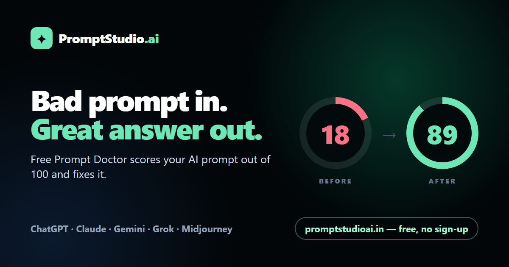

<div align="center">



# PromptStudio.ai

**Bad prompt in. Great answer out.**

Paste any AI prompt. PromptStudio scores it out of 100, shows exactly what's missing,<br/>and rewrites it for ChatGPT, Claude, Gemini, Grok or Midjourney. Free, no sign-up.

[**Try Prompt Doctor →**](https://promptstudioai.in/#doctor) · [Prompt Library](https://promptstudioai.in/prompts) · [Pricing](https://promptstudioai.in/#pricing) · [API docs](docs/API-V1.md)

</div>

---

## Why this exists

Most people get mediocre answers from AI for one reason: the prompt is missing context, a goal or a format, so the model guesses. Telling them to "write better prompts" doesn't help. Showing them a **score**, **where they lost points** and **the fixed version** does — and after a few rounds they start writing better prompts on their own.

## What's inside

| | Feature | What it does | Account |
|---|---|---|---|
| 🩺 | **Prompt Doctor** | Scores a prompt 0–100 on 5 dimensions, lists the fixes, rewrites it for the chosen AI, and makes the before → after score shareable on WhatsApp, X and LinkedIn. | Free, no sign-up |
| 📚 | **Prompt Library** | 24 fill-in-the-blank prompts for students, job seekers, small businesses, creators, developers and AI images. Each one can be sent to Prompt Doctor and tailored. | Free, no sign-up |
| 🖼️ | **Image → Prompt** | Upload a photo, poster or design and get a prompt that recreates its style, with Faithful, Professional and Creative versions. | Free account |
| ✍️ | **Prompt Builder** | Turns a rough idea into a main prompt plus 3 perspectives, with intent, assumptions and missing-info analysis. | Free account |
| 💻 | **Reference Coding** | Screenshots and reference files become build-ready prompts for Cursor, Claude Code, Lovable, v0, Bolt and more. | Free account |
| 🌐 | **Studio** | Generates a website from a brief, with live preview and delivery. | Credits |
| 📱 | **App Forge** | Packages an idea into an installable Android APK via a GitHub Actions build pipeline. | Credits |
| ⚡ | **Workflows, history, sharing, referrals** | Reusable workflows, saved history and favourites, 10-minute share links, and referral rewards. | Free / Pro |

### The Prompt Doctor rubric

Every prompt is graded on five dimensions worth 20 points each:

1. **Clear goal** — is the task and the definition of "done" explicit?
2. **Context** — audience, background, situation.
3. **Specificity** — concrete details instead of vague words.
4. **Output format** — length, structure, table/list.
5. **Constraints & tone** — quality bar, tone, things to avoid.

The rewrite never invents facts. Anything unknown becomes a highlighted `[placeholder]` for the user to fill in.

## Pricing (INR)

| Free | Pro | Creator Credits |
|---|---|---|
| ₹0 — 2 Prompt Doctor checks/day without an account, 3 generations + 1 Image → Prompt/day with one | ₹79/month or ₹499/year — 25 generations/day, 20 image prompts/month, workflows, sharing | ₹49 for 25 or ₹99 for 60 credits, one-time, never expire |

Pricing is server-authoritative (`src/config/product.config.js` + the runtime config in Firestore) and checkout runs through Razorpay.

## Tech stack

- **Frontend:** React 18, Vite 5, Tailwind CSS 3, React Router 6. Route-level code splitting keeps the landing page light (≈190 kB gzipped).
- **Backend:** Vercel serverless functions behind a single router (`api/index.js` → `server/api/*`).
- **AI:** Google Gemini (official `@google/genai` SDK) with automatic fallback to Groq, configurable via `AI_PROVIDER_ORDER`.
- **Auth & data:** Firebase Authentication and Firestore, with transactional quota/credit reservation and rollback on failure.
- **Payments:** Razorpay orders, subscriptions, signature verification and webhooks; idempotent fulfilment.
- **Integrations:** WhatsApp Business webhook, public v1 API (GPT Action ready), browser-plugin endpoint.
- **Tests:** Vitest + Testing Library.

```
src/
  pages/Landing/        Landing page + Prompt Doctor (the public hook)
  pages/PromptLibrary/  /prompts — public, SEO-indexable library
  data/promptLibrary.js Library content (edit here to add prompts)
  pages/…               Builder, Reference Coding, Studio, App Forge, Account, Admin
server/api/             Serverless handlers (generation, payments, admin, webhooks)
server/api/v1/          Public, versioned API (optimize, prompt, plugin)
server/studio/          Website generation + delivery pipeline
apk-forge/              Android wrapper project built by GitHub Actions
docs/                   Architecture, API, security and launch docs
```

## Getting started

```bash
npm install
npm run dev        # http://localhost:5173 — UI only; /api routes run on Vercel
npm test           # unit tests
npm run build      # production build
```

To exercise the API locally, use `vercel dev` with these environment variables:

| Variable | Purpose |
|---|---|
| `GEMINI_API_KEY`, `GEMINI_MODEL`, `GEMINI_FALLBACK_MODEL` | Primary AI provider |
| `GROQ_API_KEY`, `GROQ_MODEL`, `AI_PROVIDER_ORDER` | Fallback provider and ordering |
| `FIREBASE_SERVICE_ACCOUNT_KEY` *(or `FIREBASE_ADMIN_PROJECT_ID`, `FIREBASE_ADMIN_CLIENT_EMAIL`, `FIREBASE_ADMIN_PRIVATE_KEY`)* | Firestore/Auth admin access |
| `RAZORPAY_KEY_ID`, `RAZORPAY_KEY_SECRET`, `RAZORPAY_WEBHOOK_SECRET`, `RAZORPAY_PRO_MONTHLY_PLAN_ID`, `RAZORPAY_PRO_ANNUAL_PLAN_ID` | Payments |
| `PUBLIC_OPTIMIZER_RATE_LIMIT_SALT` | Salt for hashed per-IP daily limits on the free optimizer |
| `PROMPTSTUDIO_ADMIN_UID`, `PROMPTSTUDIO_ADMIN_EMAIL` | Founder/admin access |
| `RESEND_API_KEY`, `PROMPTSTUDIO_FROM_EMAIL` | Transactional email |
| `WHATSAPP_VERIFY_TOKEN`, `WHATSAPP_APP_SECRET` | WhatsApp Business webhook |
| `FORGE_GITHUB_TOKEN`, `FORGE_GITHUB_ARTIFACT_TOKEN`, … | App Forge build pipeline |

Firebase web config (`VITE_FIREBASE_*`) is public client configuration and has safe defaults in `src/firebase.js`.

## Public API

`POST /api/v1/optimize` is stateless and needs no account:

```bash
curl -X POST https://promptstudioai.in/api/v1/optimize \
  -H "Content-Type: application/json" \
  -d '{"prompt":"make a marketing post for my restaurant","target":"ChatGPT"}'
```

```json
{
  "optimized_prompt": "Write 3 Instagram captions for [restaurant name]…",
  "score": 18,
  "optimized_score": 89,
  "breakdown": { "goal": 6, "context": 2, "specificity": 4, "format": 2, "constraints": 4 },
  "improvements": ["Defined the audience as local families", "Asked for 3 captions under 60 words"],
  "link": "https://promptstudioai.in/"
}
```

See [docs/API-V1.md](docs/API-V1.md) for limits, errors and the authenticated endpoints.

## Roadmap

- [ ] Chrome extension: "Score this prompt" button inside ChatGPT, Claude and Gemini (contract in `docs/PLUGIN-CONTRACT.md`)
- [ ] Per-prompt SEO pages (`/prompts/:slug`) and Hindi/Hinglish library
- [ ] Team plan with shared prompt libraries
- [ ] Paid API keys for the optimizer
- [ ] Prompt Doctor inside WhatsApp

## Contributing

Issues and pull requests are welcome. Please read [docs/DEVELOPMENT-RULES.md](docs/DEVELOPMENT-RULES.md) first: `main` is production, so work on a branch and keep `npm test` and `npm run build` green.

---

<div align="center">Made in India 🇮🇳 · <a href="https://promptstudioai.in">promptstudioai.in</a></div>
